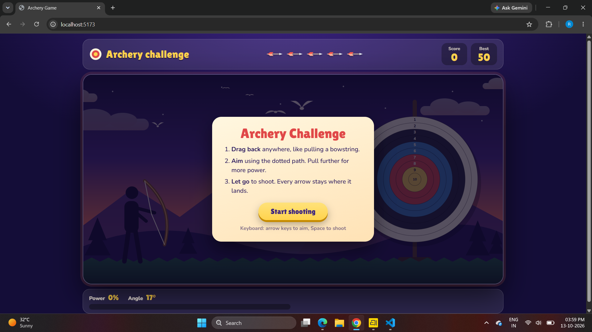
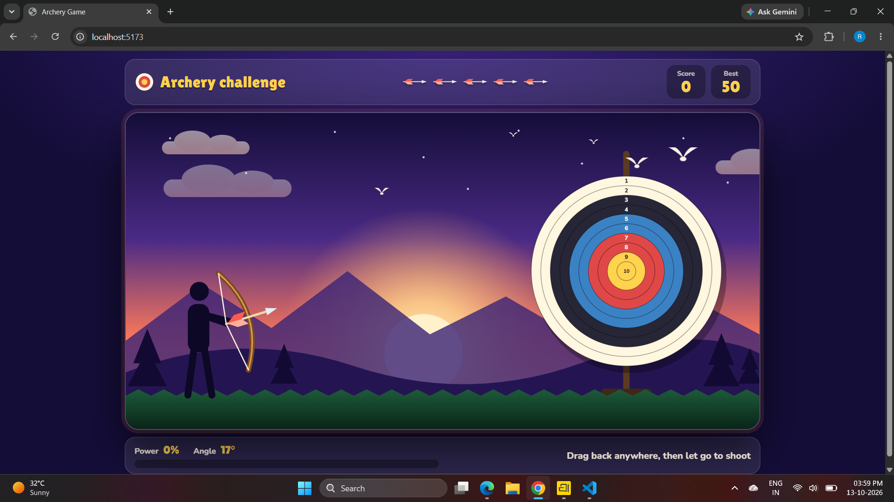
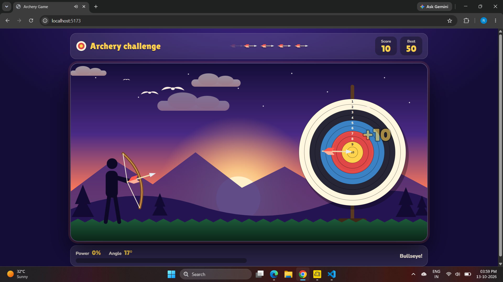
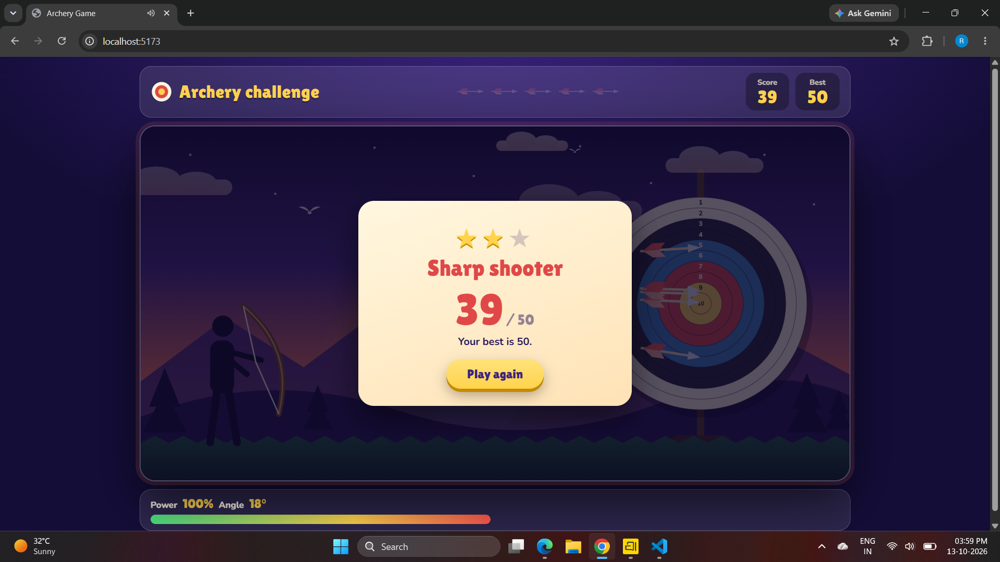

# Archery Challenge 🏹

A browser-based archery game built with **React**, **Vite**, and **CSS**. Aim at the target, pull back to set shot power, release to shoot, and try to beat your best score.

## Screenshots

### Game result


### Instructions screen


### Gameplay


### Bullseye


## Features

- Interactive archery gameplay.
- Aim and shoot by dragging back and releasing.
- Shot power and angle indicators.
- Target rings award points based on where the arrow lands.
- Score display and best-score tracking.
- Start screen, result screen, and replay option.
- Animated scenery and arrows.

## Tech Stack

- React
- Vite
- JavaScript / JSX
- CSS

## Run Locally

1. Open a terminal in the project folder.
2. Install dependencies:

   ```bash
   npm install
   ```

3. Start the Vite development server:

   ```bash
   npm run dev
   ```

4. Open the local URL printed in the terminal, usually `http://localhost:5173`.

## Project Structure

```text
archery/
├── src/
│   ├── images/
│   │   ├── archery1.png
│   │   ├── archery2.png
│   │   ├── archery3.png
│   │   └── archery4.png
│   ├── App.jsx
│   ├── App.css
│   ├── index.css
│   └── main.jsx
├── index.html
├── package.json
└── vite.config.js
```

## Screenshot paths

The screenshots are referenced using paths relative to this `README.md` file. Keep the four image files in `src/images/` and preserve the exact filenames so GitHub can render them.

---
Made with React and Vite.
